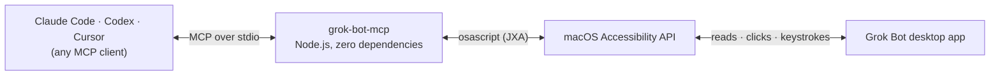

<div align="center">



# Grok Bot MCP

### Let Claude Code, Codex, Cursor — or any MCP client — drive the Grok Bot desktop app on your Mac.

List your Bots, read their chats, send them messages and answer their questions without leaving your coding agent.<br>
Every click happens live in the real app, right in front of you.

[](https://github.com/rthomas24/grok-bot-mcp/actions/workflows/ci.yml)
[](https://modelcontextprotocol.io)
[](#claude-code)
[](#codex)
[](skills/grok-bot/SKILL.md)
[](#install-in-one-line)
[](package.json)
[](LICENSE)

**[Install](#install-in-one-line)** · **[Try it](#try-it)** · **[Tools](#tools)** · **[How it works](#how-it-works)** · **[Troubleshooting](#troubleshooting)** · **[FAQ](#faq)**

</div>

---

## Why

[Grok Bot](https://x.ai/news/introducing-grok-bot) gives you Bots: AI teammates with names, jobs and their own cloud computers. Your coding agent lives in your terminal or editor. **Grok Bot MCP connects the two.**

- **Delegate.** "Ask my Researcher bot to dig into this, then summarize what it finds."
- **Catch up.** "What did my Bots get done today? One line each."
- **Unblock.** Bots ask multiple-choice questions. Answer them from Claude Code or Codex.
- **Watch it work.** Your agent drives the real Grok Bot app on your screen, so nothing happens out of sight.

No API keys. No cloud relay. No dependencies. It drives the app you already use.

## Install in one line

**You need:** a Mac · [Node.js 18+](https://nodejs.org) · the [Grok Bot desktop app](https://docs.x.ai/grok-bot/get-started), open and signed in.

### Claude Code

**Plugin (recommended):** the MCP server plus a skill that teaches Claude how to work with your Bots.

```bash
claude plugin marketplace add rthomas24/grok-bot-mcp && claude plugin install grok-bot@grok-bot-mcp
```

**Or just the MCP server:**

```bash
claude mcp add grok-bot --scope user -- npx -y github:rthomas24/grok-bot-mcp
```

### Codex

```bash
codex mcp add grok-bot -- npx -y github:rthomas24/grok-bot-mcp
```

Codex gives a tool call 60 seconds by default, and a Bot can take longer than that to answer. Give it more time in `~/.codex/config.toml`:

```toml
[mcp_servers.grok-bot]
command = "npx"
args = ["-y", "github:rthomas24/grok-bot-mcp"]
startup_timeout_sec = 60
tool_timeout_sec = 900
```

### Cursor and VS Code

[](https://cursor.com/install-mcp?name=grok-bot&config=eyJjb21tYW5kIjoibnB4IiwiYXJncyI6WyIteSIsImdpdGh1YjpydGhvbWFzMjQvZ3Jvay1ib3QtbWNwIl19)
[](https://insiders.vscode.dev/redirect/mcp/install?name=grok-bot&config=%7B%22type%22%3A%22stdio%22%2C%22command%22%3A%22npx%22%2C%22args%22%3A%5B%22-y%22%2C%22github%3Arthomas24%2Fgrok-bot-mcp%22%5D%7D)

### Claude Desktop, Windsurf, Zed, Cline or any other MCP client

```json
{
  "mcpServers": {
    "grok-bot": {
      "command": "npx",
      "args": ["-y", "github:rthomas24/grok-bot-mcp"]
    }
  }
}
```

> [!TIP]
> If your app says it can't find `npx`, put the full path from `which npx` in `"command"`.

### Add the skill to any agent (optional)

The [`grok-bot` skill](skills/grok-bot/SKILL.md) teaches your agent the workflow: check the app first, read a chat before writing in it, summarize replies, and **ask you before committing you to anything**. The Claude Code plugin already includes it. For Codex, Cursor, Gemini CLI and other agents that support [Agent Skills](https://agentskills.io):

```bash
npx skills add rthomas24/grok-bot-mcp
```

### Or let your agent install it

Paste this into Claude Code, Codex or Cursor:

```text
Install the Grok Bot MCP server for me from https://github.com/rthomas24/grok-bot-mcp (follow llms-install.md).
```

## First run: allow macOS access

Grok Bot MCP reads and clicks the Grok Bot app through the macOS Accessibility API, the same way VoiceOver does. macOS asks for permission once:

1. **Run the doctor** in the app your agent runs in (Terminal, iTerm2, Cursor, VS Code…):
   ```bash
   npx -y github:rthomas24/grok-bot-mcp doctor
   ```
2. **Automation:** when macOS asks whether that app may control "System Events" or "Grok Bot", click **Allow**.
3. **Accessibility:** open **System Settings → Privacy & Security → Accessibility**, turn on that app, then restart it.

When everything is green you're set:

```text
✓ macOS 26.0
✓ Node.js v22.20.0
✓ Grok Bot 0.70.2 installed at /Applications/Grok Bot.app
✓ Grok Bot is running (pid 4242)
✓ Accessibility and Automation access work. Found 4 agents: Grok Bot, Researcher, Coder, Marketer (open: Researcher)

All good! Ask your agent: "List my Grok Bot agents".
```

## Try it

Talk to your agent like you'd talk to a teammate who can see your Grok Bot window:

- *"List my Grok Bot agents and tell me what each one is working on."*
- *"Ask my Researcher bot for three recent sources on solid-state batteries, then summarize its answer."*
- *"Check whether the Coder bot finished the landing page. Show me what it said."*
- *"The Marketer bot asked me a multiple-choice question. Show me the options and recommend one."*
- *"Tell the Coder bot 'ship it'. Don't wait for a reply."*

## Tools

| Tool | What it does | Parameters |
| --- | --- | --- |
| `list_agents` | Lists the Bots in the sidebar and which chat is open. | none |
| `read_messages` | Reads a chat's recent messages, including a multiple-choice question the Bot is waiting on. | `agent`, `count` (1–50, default 10) |
| `send_message` | Opens the chat, types your message, presses Enter and waits for the reply. | `agent`, `message`, `wait_for_reply` (default true), `timeout_seconds` (default 180, max 900), `quiet_seconds` (default 12) |
| `answer_choice` | Clicks an option on a multiple-choice question, by letter or by text. | `choice` (`"A"` or the start of the option text), `agent`, plus the same wait options |

Agent names are case-insensitive, and a unique prefix works (`"res"` → `Researcher`). A reply looks like this:

```json
{
  "agent": "Researcher",
  "timedOut": false,
  "replies": [
    {
      "sender": "Researcher",
      "time": "9:41:14 AM",
      "text": "I found two directions. Which one should I take?",
      "question": "Which one should I take?",
      "choices": ["Go deep on one paper", "Survey ten papers", "Something else"]
    }
  ]
}
```

## How it works



- **Reads** the app's accessibility tree: sidebar, chat transcript, choice buttons. Grok Bot is an Electron app, so when Chromium's tree is switched off the server switches it back on (`AXManualAccessibility`).
- **Types** by pasting. It saves everything on your clipboard (text, images, files), pastes your message, presses Enter, then puts your clipboard back. The temporary text is marked so clipboard managers skip it.
- **Waits** by watching for new messages after the one it sent, until the chat goes quiet for `quiet_seconds` or the Bot asks a question. It sends MCP progress updates while it waits and stops if your client cancels.
- **Takes turns.** All calls run one at a time, because they share one window.
- **Stays local.** No network calls, no telemetry, no API keys. Only the Grok Bot app talks to the internet.

<details>
<summary><b>Configuration</b></summary>

Set these environment variables in your MCP client's server config if you need them:

| Variable | Default | Use |
| --- | --- | --- |
| `GROK_BOT_APP_NAME` | `Grok Bot` | The app's name, if yours differs. |
| `GROK_BOT_BUNDLE_ID` | `com.anysphere.sand` | The app's bundle ID, used to switch on its accessibility tree. |
| `GROK_BOT_POLL_MS` | `2000` | How often to check for a reply, in milliseconds. |

</details>

## Troubleshooting

Run `npx -y github:rthomas24/grok-bot-mcp doctor` first. It checks every requirement and says how to fix what's missing.

| Problem | Fix |
| --- | --- |
| "macOS blocked Accessibility access" | **System Settings → Privacy & Security → Accessibility**: turn on the app your agent runs in, then restart it. |
| "macOS blocked Automation access" | **System Settings → Privacy & Security → Automation**: let that app control "System Events" and "Grok Bot". |
| "Grok Bot is not running" | Open Grok Bot and sign in. |
| "No agent named …" | Use a name from `list_agents`; the error lists them. |
| `send_message` returns `timedOut: true` | The Bot is still working. Ask your agent to check again with `read_messages`, or raise `timeout_seconds`. |
| Codex says the tool call timed out | Raise `tool_timeout_sec` (see [Codex](#codex)). |
| The tools don't show up | Restart your agent after installing. In Claude Code, run `/mcp` to see the server's status. |

## FAQ

<details>
<summary><b>Is this an official SpaceXAI, xAI or Cursor project?</b></summary>

No. Grok Bot MCP is an independent open-source project and isn't affiliated with or endorsed by SpaceXAI, xAI, Anysphere (Cursor), Anthropic or OpenAI.
</details>

<details>
<summary><b>Does it use the Grok API? Do I need an API key?</b></summary>

No. It drives the Grok Bot desktop app you're already signed in to, so there's nothing to configure and no extra cost beyond your Grok Bot plan.
</details>

<details>
<summary><b>Does it work on Windows or Linux?</b></summary>

Not yet. Grok Bot runs on Windows and Linux too, but this server uses the macOS Accessibility API. Pull requests for Windows (UI Automation) or Linux (AT-SPI) are welcome.
</details>

<details>
<summary><b>Why does Grok Bot jump to the front when my agent sends a message?</b></summary>

To type, it has to focus the message box. Reading doesn't need focus, though opening a different chat clicks it in the sidebar.
</details>

<details>
<summary><b>Will it mess with my clipboard?</b></summary>

No. It saves every item and format on the clipboard before pasting and restores them right after.
</details>

<details>
<summary><b>Can my agent make my Bots send emails or buy things?</b></summary>

Only by asking a Bot to, the same as you typing it. The server's instructions and the skill tell agents to get your OK before sending anything that commits you to something: emails, applications, payments, account changes. Your agent's own permission prompts still apply to every tool call.
</details>

<details>
<summary><b>It broke after a Grok Bot update.</b></summary>

The server finds things by their accessibility labels, which an app update can change. Please [open an issue](https://github.com/rthomas24/grok-bot-mcp/issues/new/choose) with your `doctor` output and Grok Bot version.
</details>

## Development

```bash
git clone https://github.com/rthomas24/grok-bot-mcp && cd grok-bot-mcp
npm test                   # protocol and tool tests against a fake Grok Bot, no app needed
node src/index.js doctor   # check the real app
npx @modelcontextprotocol/inspector node src/index.js   # poke at the tools in a browser
```

```text
src/index.js           CLI entry: MCP server, `doctor`, `--version`
src/server.js          MCP over stdio (JSON-RPC 2.0), no SDK needed
src/tools.js           Tool definitions, argument checks, waiting for replies
src/grok.js            Runs the JXA script and explains macOS permission errors
src/jxa/grok-bot.js    The part that reads and clicks the Grok Bot window
skills/grok-bot/       Agent Skill for Claude Code, Codex and others
.claude-plugin/        Claude Code plugin and marketplace manifests
test/                  Tests and the fake osascript they run against
```

Contributions are welcome. See [CONTRIBUTING.md](CONTRIBUTING.md), and report security issues privately as described in [SECURITY.md](SECURITY.md).

## License

[MIT](LICENSE) © Ryan Thomas

Grok and Grok Bot are trademarks of their respective owners. This project is not affiliated with, endorsed by or sponsored by SpaceXAI, xAI, Anysphere, Anthropic or OpenAI.

<div align="center">

**If Grok Bot MCP saves you time, star the repo so others can find it.**

</div>
